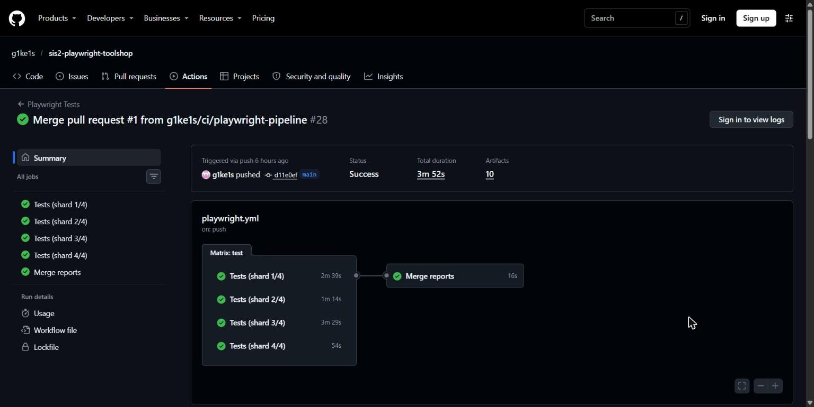
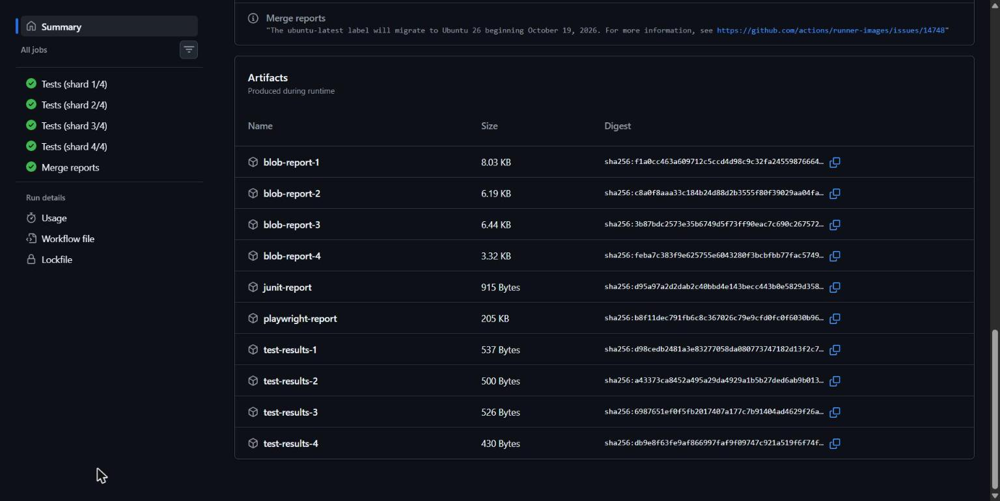

# CI-AI.md — AI use for the SIS 2 CI pipeline

## 1. Tool

| | |
|---|---|
| Tool | Claude (claude.ai, agent mode with code execution and GitHub access to this repository) |
| Model | Claude Opus 5.5 |
| Inputs | The course guide *"SIS 2: CI pipeline for Playwright — step-by-step guide"* (Google Doc) and this repository |
| AI level | Level 1: AI use is allowed and disclosed. I review and verify the output (section 5) |
| Date | 10 November 2026 |

## 2. Prompts (exactly as sent)

Six prompts, one per stage. Each ends with the result I expected, so I could
check the AI's answer against it.

**Prompt 1 — context and scope**

```text
Вот гайд SIS 2 [ссылка] и мой репозиторий [ссылка]. Прочитай оба. Перечисли требования и что для каждого уже есть или чего не хватает в репо. Пока ничего не меняй.
Результат: таблица «требование → что есть → что сделать». Видно, что текущий CI уже красный.
```

*(Read the guide and my repo; list each requirement, what exists and what is missing. Change nothing yet.)*

**Prompt 2 — diagnosis first**

```text
Посмотри последние запуски Actions на main. Почему они падают? Докажи логом или снимком страницы, не догадкой.
Результат: защита Cloudflare блокирует раннеры GitHub. Решение принимаете вы: запускать в CI локальный Toolshop в Docker.
```

*(Why do the latest runs on `main` fail? Prove it with a log or a page snapshot, not a guess.)*

**Prompt 3 — implementation on a branch**

```text
Сделай ветку `ci/playwright-pipeline`: workflow с 4 шардами и merge-job, CI-ветку в `playwright.config.ts`, `merge.config.ts`, Toolshop в Docker. Каждое отступление от гайда объясняй. Запушь и открой PR.
Результат: PR и зелёные запуски на push и на PR, лог восстановления кэша.
```

*(Branch with the 4-shard workflow, merge job, CI config, `merge.config.ts`, Toolshop in Docker; explain every deviation from the guide; push and open a PR.)*

**Prompt 4 — evidence**

```text
Сделай запуски-доказательства: ветка с `test.only` (должна упасть), ветка с флаки-тестом (должен появиться трейс). По 3 ручных запуска с 1 и 4 шардами, медианы — в README.
Результат: ссылки на все запуски и честный вывод по времени.
```

*(Proof runs: a `test.only` branch that must fail, a flaky-test branch that must produce a trace, 3 manual runs each with 1 and 4 shards, medians in the README.)*

**Prompt 5 — checking the AI itself**

```text
Сверь README и пайплайн с чек-листом гайда по пунктам. Что не подтверждено ссылкой?
Результат: список дыр, например «трейс никто не открывал».
```

*(Compare the README and pipeline with the guide's checklist item by item. What is not backed by a link?)*

**Prompt 6 — this report**

```text
Напиши `CI-AI.md`: инструмент, модель, мои промпты дословно, что сделал ИИ, что я проверил сам. Мою часть оставь с TODO.
```

*(Write this file; leave my part as TODO.)*

## 3. What the AI did, prompt by prompt

### Prompt 1 — requirements vs. repository (before any change)

| # | Requirement | What was in the repo | What to do |
|---|---|---|---|
| 1 | Runs on every push and PR | A single-job workflow | `on: push` + `pull_request`, no branch filter |
| 2 | npm cache, browsers, full suite | No `cache: npm`; `npm ci` would also download Chromium via `postinstall` | `setup-node` with `cache: npm`, `npm ci --ignore-scripts`, `playwright install --with-deps chromium`, no filters |
| 3 | HTML report + traces as artefacts ≥ 7 days | None | `upload-artifact`, `retention-days: 14`, `trace: 'on-first-retry'` |
| 4 | CI config | No `CI` branch in `playwright.config.ts` | `forbidOnly`, `retries: 2`, `blob` + `junit` reporters when `CI` is set |
| 5 | 4 shards + timing | None | Matrix 1–4, `Merge reports` job, `merge.config.ts`, timing table |
| 6 | Badge for `main` | None | Badge in README |

The existing CI on `main` was already red: runs #3–#5 (17–18 Oct) failed.

### Prompt 2 — why `main` was red

The AI added a temporary debug step (commit `e7fc979`) that printed
Playwright's `error-context.md` into the log. The page snapshot showed
Cloudflare's *"Performing security verification"* page instead of the
Toolshop: the public site blocks GitHub runners. The same 3 tests that sign in
failed in every run. **My decision:** test a local Toolshop in Docker in CI.
The debug step was removed afterwards (commit `5977e03`).

### Prompt 3 — the pipeline (branch `ci/playwright-pipeline`, PR #1)

| File | Change | Requirement |
|---|---|---|
| `.github/workflows/playwright.yml` | `push` + `pull_request` + `workflow_dispatch`; `setup-node` with `cache: npm`; `npm ci`; `playwright install --with-deps chromium`; 4-shard matrix, `fail-fast: false`; `Merge reports` job; artefacts kept 14 days, uploaded `if: !cancelled()`; `concurrency` | 1, 2, 3, 5 |
| `playwright.config.ts` | When `CI` is set: `forbidOnly`, `retries: 2`, `workers: 2`, reporters `list` + `blob` + `junit`; `trace: 'on-first-retry'`, screenshot and video on failure | 3, 4 |
| `merge.config.ts` | HTML + JUnit reporters for the merged report | 3, 5 |
| `ci/toolshop.compose.yml`, `ci/nginx.conf`, `ci/wait-toolshop.sh` | Each shard starts its own Toolshop (official prebuilt `sprint5` images), seeds the database, waits for API and UI | 2 |
| `README.md` | Badge, `## CI` section, timing table | 5, 6 |
| `.gitignore` | `reports/`, `all-blob-reports/`, `.act-artifacts/`, `.secrets` | — |

**Deviations from the guide, and why**

1. **CI tests a local Toolshop, not the public site** — Cloudflare blocks
   GitHub runners (prompt 2). Locally the tests still default to the public site.
2. **`nginx` instead of the prebuilt `web` image** — that image is arm64-only
   and failed with `exec format error` on the x64 runner (commit `641d3b6`).
3. **`npm ci --ignore-scripts`** — my `postinstall` runs
   `playwright install chromium`; without the flag Chromium would download
   twice per shard and once in the merge job, which needs no browser.
4. **`||` instead of `??` for `BASE_URL` / `API_URL`** — an unset GitHub
   variable arrives as an empty string; `??` would keep it and break every
   relative `goto()`.
5. **A `shards` input (1/4) on `workflow_dispatch`** — the guide edits the
   matrix by hand; with the input, "before" and "after" run on the same commit.
6. **An extra `tsc` type-check step** — kept from my existing setup.

**Results:** [push run](https://github.com/g1ke1s/sis2-playwright-toolshop/actions/runs/42751403712) and
[PR run](https://github.com/g1ke1s/sis2-playwright-toolshop/actions/runs/42751410495), both green.
Cache log from the PR run, shard 1:
`Cache restored from key: node-cache-Linux-x64-npm-08c88ada…`.
PR #1 merged on 10 Nov; `main` runs #28–#30 are green.

### Prompt 4 — proof runs

| What | Branch | Run | Result |
|---|---|---|---|
| Forgotten `test.only` | `ci/forbid-only-demo` | [run](https://github.com/g1ke1s/sis2-playwright-toolshop/actions/runs/42751438450) | all 4 shards fail: *"item focused with '.only' is not allowed due to the 'forbidOnly' option"* |
| Flaky test | `ci/trace-demo` | [run](https://github.com/g1ke1s/sis2-playwright-toolshop/actions/runs/42754081413) | green, test marked flaky; `test-results-1` (≈580 KB) holds the trace |
| 1 shard × 3 | `ci/playwright-pipeline` | 5 min 24 s, [1 min 39 s](https://github.com/g1ke1s/sis2-playwright-toolshop/actions/runs/42753169583), [1 min 34 s](https://github.com/g1ke1s/sis2-playwright-toolshop/actions/runs/42753584569) | median 1 min 39 s |
| 4 shards × 3 | `ci/playwright-pipeline` | 6 min 26 s, [1 min 47 s](https://github.com/g1ke1s/sis2-playwright-toolshop/actions/runs/42753360393), [1 min 31 s](https://github.com/g1ke1s/sis2-playwright-toolshop/actions/runs/42753783059) | median 1 min 47 s |

Honest conclusion (in the README): sharding cut the test step from 12 s to
9 s, but the total did not drop. The 11 tests take ~12 s, while each shard
repeats ~1 min of setup (containers, `npm ci`, Chromium).

The two demo branches were never merged.

### Prompt 5 — gaps: what is not backed by a link

| # | Gap | Fix |
|---|---|---|
| 1 | **Nobody has opened the trace** in trace.playwright.dev; only the artefact size proves it exists | Download `test-results-1` from the trace-demo run, open it, add a screenshot (TODO in §5) |
| 2 | The README does not link the cache-restore log | Link the PR run / quote the log line (done in §3 here) |
| 3 | The two slow outlier runs (5 min 24 s, 6 min 26 s) have no links in the README | Add their links |
| 4 | Artefacts from 10 Nov expire on **24 Nov**; the repository's artefact-retention setting was not checked | Check Settings → Actions → General; keep the screenshots in `screenshots/` |
| 5 | `trace: 'on-first-retry'` records the **retry**, not the failed first attempt; the config comment says otherwise | Fix the comment |
| 6 | The CI mode was never run locally with a real browser (the AI's sandbox could not download Chromium; it only ran `--list`) | Run `CI=true npx playwright test` locally (TODO in §5) |
| 7 | The README linked `CI-AI.md` while the file was deleted (commit `5642d5e`) | This file |
| 8 | CI covers the `sprint5` build, not the live public site | Stated in the README; accepted trade-off |
| 9 | Optional guide step 4 (Docker image / `act`) was not done | Optional |

## 4. What the AI checked itself

| Check | Result |
|---|---|
| `npx tsc -p .` | no errors |
| `actionlint .github/workflows/playwright.yml` | no errors |
| `CI=true npx playwright test --list --shard=i/4` | 3 + 3 + 3 + 2 = 11 tests (`fullyParallel` splits tests, not files) |
| `test.only` with `CI=true` locally | fails with the `forbidOnly` error |
| 2 shards → `merge-reports --config merge.config.ts` | one HTML report + `reports/junit-merged.xml` with `tests="11"` |
| GitHub API: runs, job logs, artefacts | as in §3 |

## 5. My review and verification

| # | What I checked | How | Result |
|---|---|---|---|
| 1 | Read every changed line and compared it with the guide | `git diff 28b5ca2 main` | TODO |
| 2 | Push run and PR run exist and are green | Actions tab | TODO |
| 3 | npm cache restored on the second run | `setup-node` log | TODO |
| 4 | 4 shards in parallel, then `Merge reports` | Run graph | TODO  |
| 5 | Artefacts `playwright-report`, `test-results-1…4`, `junit-report` | Run page | TODO  |
| 6 | A trace opens | `test-results-1` from the trace-demo run → trace.playwright.dev | TODO |
| 7 | `forbidOnly` fails CI | forbid-only run log | TODO |
| 8 | CI mode locally | `CI=true npx playwright test` | TODO |
| 9 | Timing medians match the run pages | Actions | TODO |
| 10 | Badge shows `main` status | README front page | TODO |

### What I changed myself

- I did not change the code. I checked the runs, merged the PR and took the
  screenshots.

### What I learned

- Working with pull requests: a feature branch, a PR into `main`, CI runs for
  both the push and the PR, then the merge.
- Building and running Docker images: starting the Toolshop with
  `docker compose` in CI, and why an arm64-only image fails on an x64 runner.
- Reading GitHub Actions logs and artefacts to find the real cause of a failure
  (the Cloudflare check), instead of guessing.
