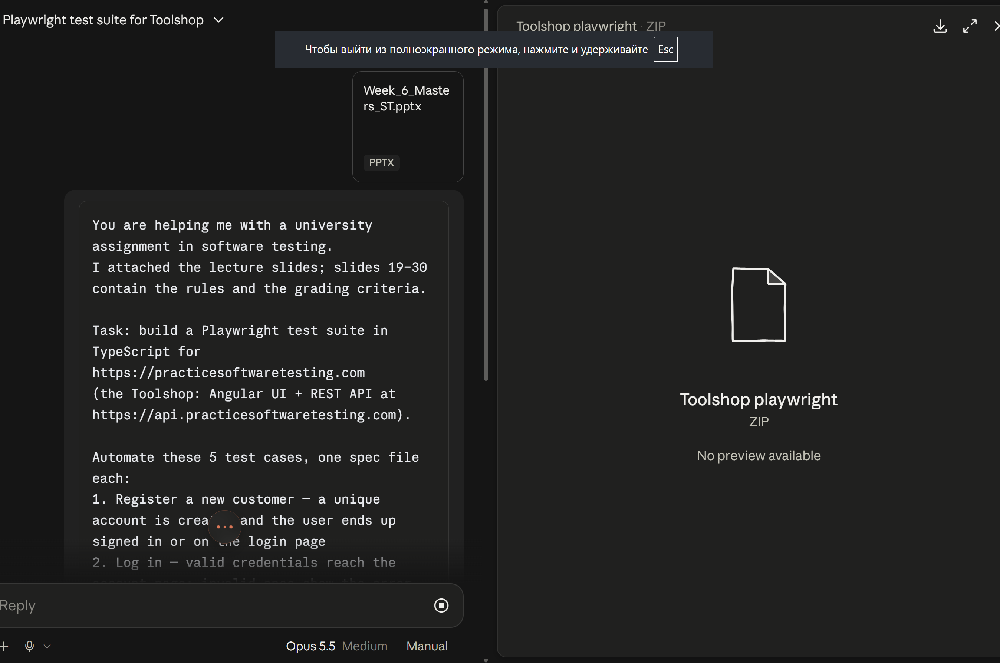

# Prompt.md

## Tool

| | |
|---|---|
| Tool | Claude (claude.ai, agent mode with code execution) |
| Model | Claude Opus 5.5 |
| Effort | Medium effort |
| Attachment | `Week_6_Masters_ST.pptx` (lecture slides with the SIS 2 brief) |
| AI level | Level 1: allowed and disclosed; I review and correct the output (see Review.md) |

## Prompt (exactly as sent)

```text
You are helping me with a university assignment in software testing.
I attached the lecture slides; slides 19–30 contain the rules and the grading criteria.

Task: build a Playwright test suite in TypeScript for https://practicesoftwaretesting.com
(the Toolshop: Angular UI + REST API at https://api.practicesoftwaretesting.com).

Automate these 5 test cases, one spec file each:
1. Register a new customer — a unique account is created and the user ends up signed in or on the login page
2. Log in — valid credentials reach the account page; invalid ones show the error and do not
3. Buy a product — add to cart → cart shows the right item and quantity → checkout completes
4. Compare two products — open two products, capture name and price, assert a stated comparison
5. Reset a password — known e-mail gets a confirmation, invalid e-mail gets an error
```


```
## Why I wrote the prompt this way


- **I attached the slides and pointed to slides 19–30.** That way the AI could
  read the rules and grading criteria itself instead of me paraphrasing them.
- **I named the stack and both URLs (UI + API).** The AI then knew it could use
  the REST API to set up test data.
- **I wrote each test case with its expected outcome.** That steers the AI
  towards real assertions, not just clicking through pages.
- **I asked for one spec file per case.** That keeps the 5 suites separate and
  easy to grade.

## Follow-up prompts

The first draft (above) had 5 spec files and 10 tests. Everything below is
what I did after I ran that draft myself (see Review.md §1–2 for what broke).
Same tool/model throughout: Claude, claude.ai agent mode, Claude Opus 5.5.

### Fix 1 — Remove the shared `storageState` session, add `registeredUser` fixture

**AI used?** Yes

**Prompt:** (polished)
> I ran the suite. Remove the auth.setup / storageState login-once step: TC-05
> resets the password and every test uses its own fresh user, so a shared
> session breaks independence. Give each test its own API-registered user via
> a fixture instead. Also add a negative test for [registration with an
> already-used e-mail / malformed e-mail on forgot-password] so each suite has
> a negative case.

**Context I gave the AI:** the failing run, and which test order made it fail.

**What I kept, changed or rejected, and why:** kept the fixture approach it
proposed; this produced the `registeredUser` fixture and the
`freshUser`-per-test pattern used across all specs. See Review.md row 1.

**Evidence it works:** `--repeat-each=5 --workers=6` → 55/55 (Review.md §4).

### Fix 1b — Add TC-01.3 (submit an empty registration form)

**AI used?** No — manual.

Removing the shared-session setup in Fix 1 left the suite one test short of
the 11 required by Description.md. I wrote `submitEmpty()` on
`register.page.ts` and the TC-01.3 test in `tests/register.spec.ts` myself,
mirroring the pattern `login.page.ts` already used for its own empty-submit
case.

### Fix 2 & 3 — Reset-password banner assertion, checkout 422 from postcode lookup

**AI used?** Yes

**Prompt:** (polished)
> Fix the reset-banner issue, the checkout 422. Make sure everything works.

**Context I gave the AI:** the trace showing the banner renders as the raw
key `page.forgot-password.confirm` and disappears after ~3s, and the API
response body from the failing checkout (`422`, "city does not belong to
country"). I captured these myself at the time, from the trace viewer and the
browser's network tab — not regenerated for this write-up.

**What I kept, changed or rejected, and why:** for the banner, I kept
asserting on role (an alert that is not an error) rather than its text, then
proved the reset worked by signing in with the new password — stronger than
matching text that's actually a broken i18n key. For checkout, I kept
building the address from the same postcode lookup the app uses, and waiting
on `toHaveValue` instead of a fixed timeout, so the wait ends exactly when
the re-fill actually happens. See Review.md rows 2–3.

**Evidence it works:** `--repeat-each=5 --workers=6` → 55/55, no more 422s or
banner-text flakes (Review.md §4). The original failing run and its trace
were not kept; only the green re-run is still around.

### Fix 4 — Out-of-stock hard-coded product

**AI used?** No — manual.

Found with `--repeat-each=5`: the hard-coded product in the buy test went
out of stock after repeated runs, disabling the quantity field. I changed
the test myself to pick the first in-stock product at runtime and assert on
the name/price it captures, rather than asking the AI to patch this one.

### Fix 5 & 6 — `tsc` errors and missing browser on a clean clone

**AI used?** No — manual.

- Ran `npx tsc -p .`, added `@types/node` to `package.json` and
  `"types": ["node"]` to `tsconfig.json`.
- Tried a fresh clone, saw Playwright fail to launch Chromium, added
  `"postinstall": "playwright install chromium"` to `package.json`.

**Evidence it works:** reproduced by temporarily reverting each fix and
re-running, then restoring.

`npx tsc -p .` with `@types/node` removed:

```text
error TS2688: Cannot find type definition file for 'node'.
  The file is in the program because:
    Entry point of type library 'node' specified in compilerOptions
```

`npx playwright test` with the cached Chromium build hidden (simulating a
clean clone before the `postinstall` line existed):

```text
Error: browserType.launch: Executable doesn't exist at
C:\Users\g1kss\AppData\Local\ms-playwright\chromium_headless_shell-1194\chrome-win\headless_shell.exe
╔═════════════════════════════════════════════════════════════════════════╗
║ Looks like Playwright Test or Playwright was just installed or updated. ║
║ Please run the following command to download new browsers:              ║
║                                                                         ║
║     npx playwright install                                              ║
╚═════════════════════════════════════════════════════════════════════════╝
1 failed
```

Both fixes restored and re-verified passing afterwards.
