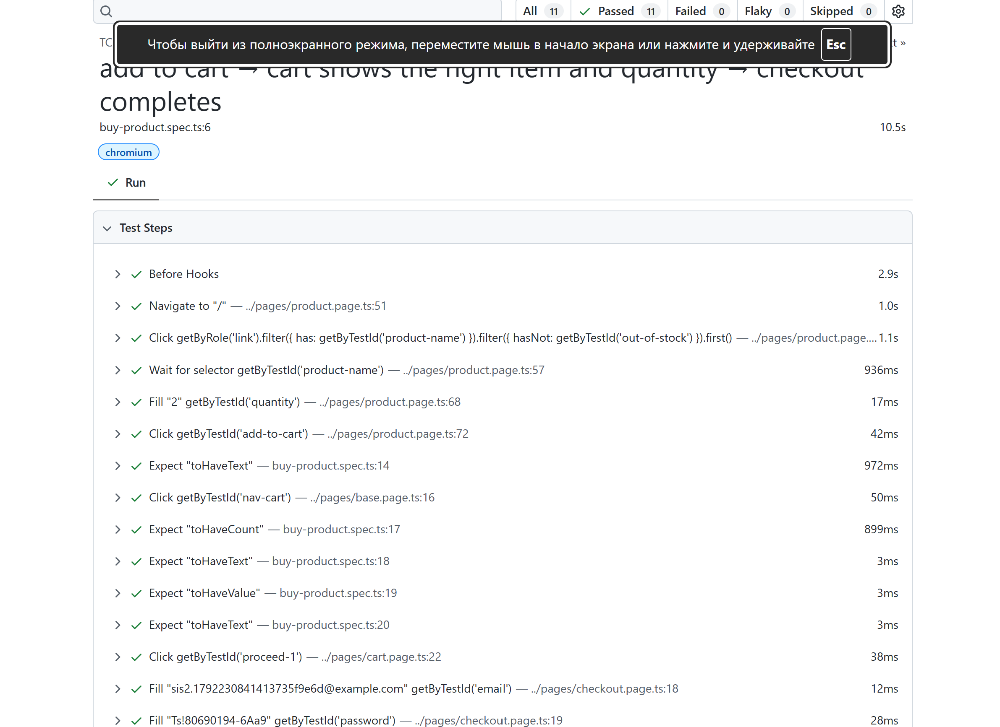

# SIS 2 — Playwright tests for the Toolshop

[](https://github.com/g1ke1s/sis2-playwright-toolshop/actions/workflows/playwright.yml)

Automated acceptance tests for <https://practicesoftwaretesting.com>, written in
TypeScript with Playwright Test.

- **What is tested and why:** [Description.md](Description.md)
- **AI prompt and tool:** [Prompt.md](Prompt.md)
- **AI review and corrections:** [Review.md](Review.md)
- **AI use for the CI part:** [CI-AI.md](CI-AI.md)
- **Screenshots:** [screenshots/](screenshots)

## Run it

```bash
npm install            # also installs Chromium (postinstall)
npx playwright test    # 5 suites, 11 tests, parallel
npx playwright show-report
```

Other targets:

```bash
# a local Toolshop (docker / source) — or any other build, e.g. the with-bugs one
# (set API_URL to the API that build uses)
BASE_URL=http://localhost:4200 API_URL=http://localhost:8091 npx playwright test
```

## Results



## CI

[](https://github.com/g1ke1s/sis2-playwright-toolshop/actions/workflows/playwright.yml)

**CI system:** GitHub Actions. The repository already lives on GitHub, so it
needs no server of its own, it is free for public repositories, and its job
matrix gives sharding with a few lines of YAML.

**Pipeline** (`.github/workflows/playwright.yml`):

- runs on every push and every pull request (no branch filter), plus manual
  runs (`workflow_dispatch`) for the timing below;
- `actions/setup-node` with `cache: npm`, then `npm ci`, then
  `npx playwright install --with-deps chromium`, then `tsc` type-check;
- the full suite with no filters, split into 4 shards (`--shard=i/4`)
  running in parallel (`fail-fast: false`, so one red shard does not cancel the others);
- the `Merge reports` job merges the shards' blob reports into one HTML
  report and one JUnit file;
- artefacts, uploaded even when tests fail: `playwright-report` (HTML),
  `test-results-N` (traces, screenshots, videos, per-shard JUnit),
  `junit-report` (merged JUnit); kept for **14 days**.
- a newer push to the same branch cancels the outdated run (`concurrency`).

**CI settings** (`playwright.config.ts`, when `CI=true`): `forbidOnly: true`,
`retries: 2`, `workers: 2`, reporters `list` + `blob` + `junit`
(`reports/junit.xml`); `trace: 'on-first-retry'`, screenshot and video on failure.
Locally (no `CI`) the config keeps the `html` reporter and no retries.
`merge.config.ts` builds the merged report.

The target site can be changed without editing code: set `BASE_URL` / `API_URL`
under *Settings → Secrets and variables → Actions → Variables*; when unset, the
public Toolshop is used.

To open a trace: download `test-results-N`, then
`npx playwright show-trace <path>/trace.zip`, or drop the file on
<https://trace.playwright.dev>.

### Runtime

"Before" = the same workflow with 1 shard, "after" = 4 shards. Both come from
GitHub Actions: *Actions → Playwright Tests → Run workflow*, `shards` = `1` or `4`.

| Configuration | Total run time | Run tests step (slowest shard) | Run |
| --- | --- | --- | --- |
| 1 job, no sharding | X min Y s | X min Y s | [run](LINK) |
| 4 shards + merge | X min Y s | X min Y s | [run](LINK) |

Median of 3 `workflow_dispatch` runs per configuration.
Conclusion: TODO (with 11 tests and ~1 min of setup per shard, the total may
drop only a little; the test step itself shrinks, the setup does not).

### Running the CI mode locally

```bash
npm ci
npx playwright install --with-deps chromium
CI=true npx playwright test                 # PowerShell: $env:CI="true"; npx playwright test

# shards + merge, as in CI
mkdir -p all-blob-reports
CI=true npx playwright test --shard=1/2; cp blob-report/*.zip all-blob-reports/
CI=true npx playwright test --shard=2/2; cp blob-report/*.zip all-blob-reports/
npx playwright merge-reports --config merge.config.ts ./all-blob-reports
npx playwright show-report
```
