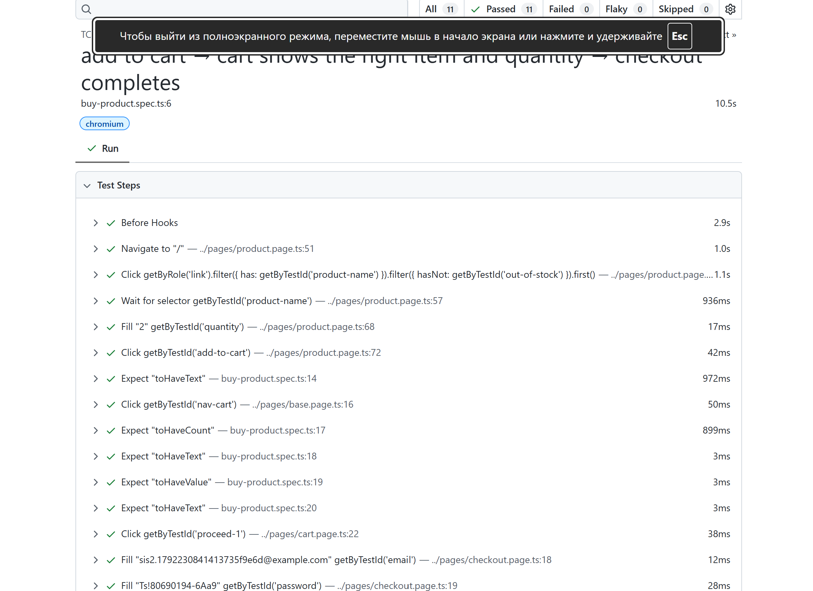

# SIS 2 — Playwright tests for the Toolshop

Automated acceptance tests for <https://practicesoftwaretesting.com>, written in
TypeScript with Playwright Test.

- **What is tested and why:** [Description.md](Description.md)
- **AI prompt and tool:** [Prompt.md](Prompt.md)
- **AI review and corrections:** [Review.md](Review.md)
- **Screenshots:** [screenshots/](screenshots)

## Run it

```bash
npm install            # also installs Chromium (postinstall)
npx playwright test    # 5 suites, 11 tests, parallel
npx playwright show-report
```

Other targets:

```bash
# a local Toolshop (docker / source) — or any other build, e.g. the with-bugs one
# (set API_URL to the API that build uses)
BASE_URL=http://localhost:4200 API_URL=http://localhost:8091 npx playwright test
```

## Results


